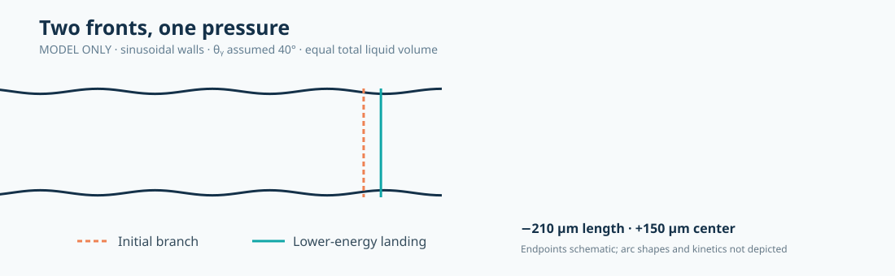

# Contact-angle hysteresis: two-front statics and experimental validation

This is **exploratory, independent research**, extending the 2019 microchannel
statics model of Hatipogullari *et al.* to a finite liquid plug in a periodically
corrugated channel. It is meant to provide a **cheap, falsifiable alternative to
full flow simulations**, not a claim of new experimentally confirmed physics.

**Evidence status (17 Oct 2026): internally verified model, quantitative
experimental agreement NOT established.** No measured channel-wall trace,
independently determined Young angle, or time-resolved trajectories of both
individual contact lines are included. Neither experimental dataset is bundled.

## A reproducible model-only result

Assumptions for the illustrative Poulose-shaped test case:
- nominal width 1.00 mm, depth 0.38 mm; sinusoidal width amplitude 0.05 mm
  (we interpret the reported ~10% variation as *peak to peak*);
- ripple wavelength 0.30 mm; assumed intrinsic Young angle 40°;
- two *plan-view circular arcs* with a **single shared pressure** and prescribed
  total plug volume, free left/right endpoints and meniscus angles;
- full constrained free-energy Hessian, not a one-coordinate fold alone.

The symmetric branch loses its first constrained stability near **0.32163 µL**,
before its symmetric volume fold at **0.27188 µL**. The selected positive-direction,
equal-volume lower-energy landing has a **209.68 µm predicted reduction** in outer
contact-line separation and a **150 µm shift** of plug centre. An equally permitted
negative-direction landing exists by reflection.

These are **outputs of the assumed model**, not observed jump lengths. They should
not be cited as an experimental match. The circular-arc approximation may be poor
when the arc extent is comparable with the corrugation wavelength.



## Theory and experiments: what matches?

| Quantity | Model | Existing experiment | Evidence strength |
|---|---|---|---|
| Intermittent motion in a corrugated channel | Equilibrium loss and jumps | Reported by Poulose et al. (2023) | **Qualitative correspondence** |
| Changes in outer contact-line separation versus inner-meniscus separation | Different predicted changes | Different behaviour reported | **Qualitative only**; no per-jump tracks |
| 209.7 µm jump, 0.3216 µL threshold, 150 µm translation | Predicted for assumed inputs | **Not independently measured** in this package | **Untested** |
| Curvature reversal for ~60° at expansion | Local geometric angle criterion | Yan et al. (2025) report reversal at 60°, not 95° or 120° | **Qualitative correspondence** |
| Fast pore-filling versus pump-only volume | Storage/compliance necessary for some events | Published images/traces | **Figure-estimated diagnostic**, not calibrated compliance |
| Pressure jump sizes across wettabilities | Not predicted by complete 3D model | Yan et al. measured pressure | **Unvalidated** |

### Important interpretation

The 2023 experiment follows **two interfaces**. Changing outer-line separation
\(L\) and innermost-point separation \(l\) cannot be conflated; the latter also
depends on curvature. We predict their different responses but cannot test
individual jump sizes from published five-minute sampling alone.

The 2025 pore-filling apparatus can release stored liquid rapidly, so a
pressure-controlled, compliant apparatus model is needed for an honest
quantitative comparison. Do **not** fit compliance from one coarse plot and
describe it as a measured apparatus property.

Our independent arithmetic check found a mismatch between one published
worked volume example and the values obtained by substituting its printed
dimensions. This has **not** been verified against experimental raw data;
it is not evidence of an incorrect experimental finding.

## Run locally

Python 3.11+:

```sh
pip install -r cah-statics/requirements.txt
python cah-statics/tests/test_model.py
python cah-statics/plot.py
python cah-statics/audit_pore.py
```

The tests verify internal equations and local stable branches; figure generation
writes PNG, SVG and CSV/JSON to `cah-statics/outputs/`.
From GitHub's **Actions** tab, run **CAH statics — reproducible figures**
manually to regenerate the outputs. A lightweight PR check runs only when this
study changes; there is **no schedule** and no paid datasets.

The workflow does not download raw experiment files without their data rights,
and it does not automatically declare empirical agreement.

## Next validation experiment (Fuentes-style)

1. Independently digitize the *actual wall profile* \(w(x)\) and calibrated
   Young/contact-angle behaviour of the laser-cut channel.
2. Retrieve raw video and pressure data, mark \(x_L(t)\), \(x_R(t)\), \(L(t)\),
   \(l(t)\), volume and time; preserve raw and processed uncertainties.
3. Replace local circular arcs with **true Young–Laplace interfaces** in the
   measured corrugated geometry, enforcing shared pressure.
4. Add apparatus compliance and gas storage only where supported by independent
   apparatus specifications or new measurements.
5. Blind-predict multiple separate jumps; report signed errors and uncertainty
   intervals for critical thresholds, landing positions and jump magnitudes,
   including failures. Until then, **do not report percent agreement**.

## References and provenance

- Hatipogullari, Wylock, Pradas, Kalliadasis & Colinet (2019),
  [Contact angle hysteresis in a microchannel: Statics](https://doi.org/10.1103/PhysRevFluids.4.044008).
- Poulose et al. (2023),
  [experiment and images](https://arxiv.org/abs/2210.16962),
  [published paper](https://doi.org/10.1109/LMAG.2023.3262976).
- Yan et al. (2025),
  [pore-filling experiments](https://doi.org/10.1016/j.jcis.2025.137884),
  [independent data archive](https://doi.org/10.18419/DARUS-4683).

This code is an independently written reduced model. It does not incorporate
authors' copyrighted experimental photographs, proprietary image series, or
upstream simulation source. Scientific credit goes to the above work.


## Research update: local bifurcation classification

See [Round 2: symmetry breaking and quartic-sign criterion](ROUND2_BIFURCATION.md). The earlier finite-jump calculation does not apply universally to all contact angles; a smooth onset is predicted in another part of parameter space.
